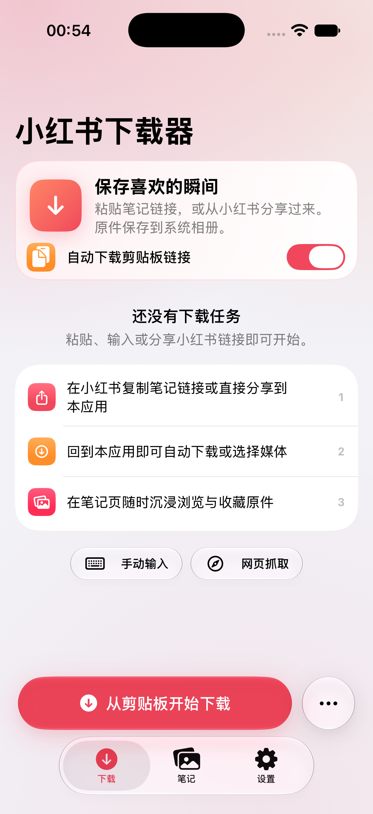
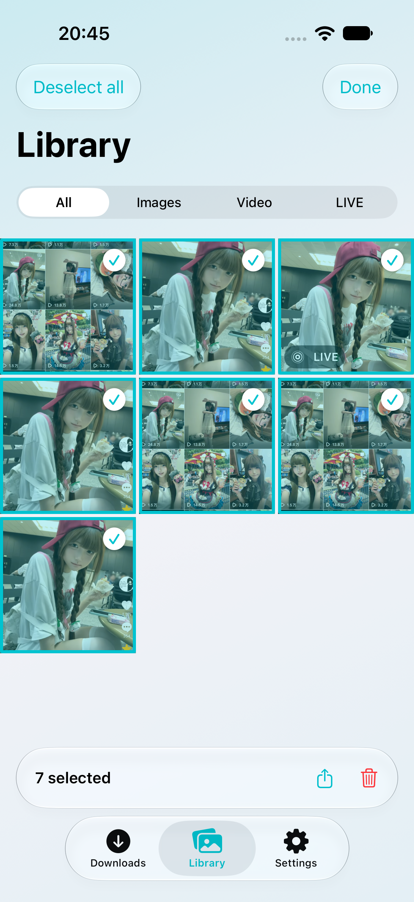

<div align="center">


# 小红书下载器 · XHS Downloader for iOS

**面向 iOS 26 的原生小红书无水印原件与实况下载器**

[](https://developer.apple.com/ios/)
[](https://swift.org/)
[](https://github.com/MiohalationM/XHS_Downloader_iOS/releases)
[](LICENSE)

[功能特性](#-功能特性) · [页面截图](#-页面截图) · [安装与使用](#-安装与使用) · [源码构建](#-源码构建) · [上游致谢与协议](#-上游致谢与开源协议)

</div>

---

## ✨ 功能特性

- **iOS 26 原生交互**：下载、笔记、设置三标签原生导航，采用 Liquid Glass 材质、iPad 自适应分栏布局与全链路触感反馈。
- **多入口链接捕获**：
  - **剪贴板自动识别**：回到前台时自动识别小红书链接并加入队列（可在设置中关闭，自动去重且跳过应用内复制）。
  - **系统分享扩展**：在小红书 App 内通过系统分享直接推送至下载队列（基于 App Group）。
  - **手动输入 & 网页抓取**：支持粘贴含文案的混合文本，支持内置网页会话抓取。
  - **全域名兼容**：支持 `xiaohongshu.com`、`rednote.com` 笔记链接以及 `xhslink.com`、`xhslink.cn/o/...` 等短链接。
- **无损原件与 Live Photo**：
  - 优先获取 `fileId` 对应的原始文件，保留 **HEIC / 原图格式与 HDR 显示**，不再强制转码 JPEG。
  - **实况照片（Live Photo）**：支持「合成实况」「组件分别保存」或「仅静态」；采用不重编码的 EXIF 配对与视频样本直通封装，无法无损配对时自动降级保留原始组件并明确提示。
  - **元数据清理**：导入系统相册时自动清理小红书写入图片说明的内部处理 JSON，保留作者原始说明与色彩/增益图信息。
- **可控的后台下载引擎**：
  - 支持「下载前选择」模式，先加载预览再勾选保存，等待选择不阻塞其他任务。
  - 基于后台 `URLSession` 实现断点续传、实时字节与速度显示、HTTP/媒体真实格式校验、暂停/继续与失败重试。
- **双列瀑布流笔记库与沉浸阅读**：
  - 按笔记展示双列瀑布流（iPad 与横屏自动增加列数），支持喜欢/收藏（仅本地保存）、类型筛选及标题/正文/作者/话题搜索。
  - 连续展开动画进入详情，支持全屏双指缩放、双击放大、实况长按播放、下拉及左边缘侧滑返回，以及批量多选分享/导出/删除。
- **双存储位置与完整备份**：
  - 支持保存至系统相册（“小红书下载器”相册，兼容有限照片访问权限）或 **Files 文件夹**（持久化目录授权，支持重新授权）。
  - 支持导出诊断信息（自动脱敏 Cookie 与代理凭据）及应用记录备份恢复。

---

## 📱 页面截图

<div align="center">
<table>
  <tr>
    <td align="center" width="33%">
      <br />
      <strong>下载主页</strong><br />
      <sub>剪贴板自动识别 · 引导卡片 · 网页抓取</sub>
    </td>
    <td align="center" width="33%">
      <br />
      <strong>媒体库与多选管理</strong><br />
      <sub>分类筛选（图片 / 视频 / 实况）· 批量操作</sub>
    </td>
    <td align="center" width="33%">
      <br />
      <strong>全屏原件与实况查看</strong><br />
      <sub>无损缩放 · 长按播放 Live Photo · 静音切换</sub>
    </td>
  </tr>
</table>
</div>

---

## 🚀 安装与使用

### 方式一：安装发行版 IPA（推荐）

1. 前往本仓库 [Releases](https://github.com/MiohalationM/XHS_Downloader_iOS/releases) 页面下载最新版本的 `.ipa` 文件。
2. 发行版 `.ipa` 为未签名 / 假签名包，请使用 **TrollStore / AltStore / SideStore / Sideloadly** 或个人证书自签安装。

### 方式二：从源码构建

- **环境要求**：macOS + Xcode（支持 **iOS 26.0 SDK**）
- 克隆仓库并用 Xcode 打开 `XHS_Downloader_iOS.xcodeproj`：
  ```bash
  git clone https://github.com/MiohalationM/XHS_Downloader_iOS.git
  cd XHS_Downloader_iOS
  open XHS_Downloader_iOS.xcodeproj
  ```
- 修改主目标与 `ShareExtension` 的签名 Team（如真机调试需配置对应 Bundle ID 与 App Group），选择真机或 iOS 26 模拟器运行。
- 本机脚本调试与单元测试可参考 [开发环境说明](docs/DEVELOPMENT_ENVIRONMENT.md) 与 `./scripts/ios-dev.sh`。

### 基本使用步骤

1. 在小红书复制笔记链接后打开本应用，默认自动解析并加入下载；也可通过底部 **「从剪贴板开始下载」**、**「手动输入」** 或小红书系统分享菜单触发。
2. 如需筛选单篇笔记中的部分图片/视频，可在 **设置** 中开启 **「下载前选择」**。
3. 下载完成后可在 **笔记** 页或系统相册的 **「小红书下载器」** 相册中查看与管理。
4. 如不希望应用自动读取剪贴板，可在 **设置** 中关闭 **「自动下载剪贴板链接」**。

---

## 🙏 上游致谢与开源协议

本项目基于以下开源项目参考与衍生开发，特此向原作者与贡献者致以诚挚感谢：

| 上游项目 | 仓库地址 | 说明 |
| :--- | :--- | :--- |
| **XHS_Downloader_iOS** | [NEORUAA/XHS_Downloader_iOS](https://github.com/NEORUAA/XHS_Downloader_iOS) | iOS 端基础架构与实现参考 |
| **XHS_Downloader_Android** | [NEORUAA/XHS_Downloader_Android](https://github.com/NEORUAA/XHS_Downloader_Android) | 移动端交互与下载逻辑参考 |
| **XHS-Downloader** | [JoeanAmier/XHS-Downloader](https://github.com/JoeanAmier/XHS-Downloader) | 桌面端核心解析与接口设计最上游 |

### 开源协议（AGPL-3.0）

本项目严格遵守上游项目的 **[GNU Affero General Public License v3.0 (AGPL-3.0)](LICENSE)** 开源协议：

- 本项目同样采用 **AGPL-3.0** 协议开源。
- 任何个人或组织在分发、修改本项目代码（包括通过网络提供服务）时，必须完整保留原始版权声明与协议文本，并以相同的 **AGPL-3.0** 协议公开完整源代码。

---

## ⚠️ 使用须知

- 请仅下载自己需要的内容，严格遵守相关法律法规与平台规则。
- 请尊重笔记原作者的知识产权与版权，合理使用下载内容，严禁用于商业或侵权用途。
- 本应用仅供个人学习、技术交流与研究使用，下载内容请于 24 小时内删除。

---

## 💬 反馈与支持

如在使用过程中遇到问题或有功能建议，欢迎前往 [Issues](https://github.com/MiohalationM/XHS_Downloader_iOS/issues) 反馈，或直接提交 Pull Request 共同完善本项目。
